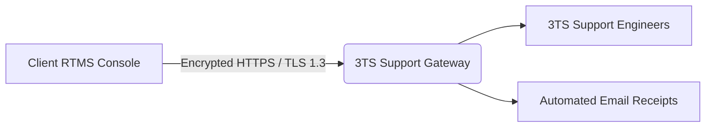
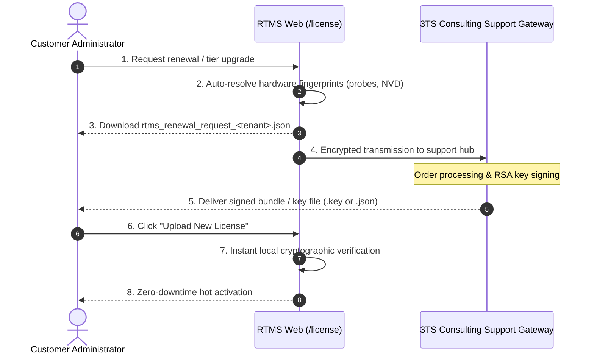

# Technical Support, Secure Gateway & Software Updates

The RTMS platform integrates a direct, secure channel with the **3TS Consulting** central technical support hub, enabling real-time incident ticketing, proactive software update deployment, and automated license lifecycle management.

---

## 1. Submitting and Tracking Support Tickets

Accessible via **Help > Support** (`/help/support`):

### Key Capabilities:
* **Direct Ticket Submission**: Formulate ticket subject, priority (*Low, Normal, High, Critical*), and comprehensive issue descriptions.
* **Optional Diagnostic Telemetry**: Option to bundle non-sensitive platform status metadata (operating system environment, RTMS version, asset count).
  > [!NOTE]
  > No confidential client data (passwords, cleartext network payloads, or personal customer information) is included in diagnostic packages.
* **Real-Time Ticket Tracking**: View status updates, resolution notes from 3TS engineers, and track progress until closure directly from the portal.

---

## 2. Communication Security & Zero-Trust Architecture

All communications between your on-premises RTMS instance and the central support infrastructure adhere to rigorous security standards:

* **End-to-End Encryption (SSL / TLS 1.3)**:  
  All traffic travels exclusively over HTTPS via standard secure port `443` using modern TLS cipher suites and HSTS (*HTTP Strict Transport Security*).
* **Asymmetric Instance Cryptographic Identity (Zero-Trust Ed25519)**:  
  Your RTMS instance generates its own unique Ed25519 asymmetric keypair during setup:
  * **The private key** remains strictly protected within your local server boundary and is never transmitted over the wire.
  * **Each outbound request** is cryptographically signed using an ephemeral authentication token (15-minute validity), guaranteeing message authenticity and preventing replay or spoofing attacks.
* **Corporate API Key Alternative (Bearer Token)**:  
  Clients with specialized outbound proxy policies can alternatively authenticate using a static corporate API key issued by 3TS.

---

## 3. Software Updates Management (`/security/software`)

The **Administration > Software Updates** workspace supports continuous cyber resilience compliance (NIS 2 / Cyber Resilience Act):

1. **Automated Discovery**: The platform polls the official release registry to detect security patches and functional releases.
2. **Release Notes & Fix Details**: Transparent display of resolved vulnerabilities and target component versions (core scanner probe, web dashboard, local NVD engine).
3. **Cryptographic Integrity Validation**: Every staged package is verified against its SHA-256 hash before installation, ensuring tamper-proof delivery.

---

## 4. License Lifecycle & Expansion Requests (User Procedure)

Subscription license administration for customer organizations is managed entirely from the RTMS Web portal via **Settings > Subscription & License** (`/license`).

Customer organizations do not have direct access to raw RSA key signing tools (which remain strictly restricted to 3TS internal authorities): the official customer procedure relies on the **renewal request and bundle import cycle (Option B)**.

### Step 1: Review Current License Status
From the `/license` dashboard:
* Check your active plan tier (**NVD**, **Discovery**, **Secure**, or **Compliance**) and its expiration date.
* Monitor your asset utilization gauge against the licensed node cap (e.g., 248 / 250 IPs).
* Inspect the list of registered network probes, local agents, and microservices along with their Hardware IDs.

### Step 2: Trigger Renewal or Tier Upgrade Request
1. Click **"Upgrade License"** (or **"Request Early Upgrade"** if asset count approaches capacity).
2. Choose the **Desired Plan** and target **Asset Tier** (e.g., 50, 250, 500, or 1000+ monitored IP addresses).
3. Optionally enter business or architecture notes in the provided field.

### Step 3: Generate and Transmit Request
Click **"Generate Request File"**:
* **Automatic Hardware Fingerprint Binding**: The system automatically queries your appliance to resolve the unique hardware UUIDs of all active network probes and local services without requiring manual command-line extraction.
* **Local Request File Download**: A backup file named `rtms_renewal_request_<tenant_id>.json` is automatically saved to your downloads folder.
* **Automated Gateway Transmission**: If configured with the 3TS Central Support Hub, the request is dispatched immediately over TLS 1.3 with an acknowledgment reference (`RTMS-LIC-YYYY-XXXX`). Otherwise, simply email the `.json` file to your designated 3TS account representative.

### Step 4: Import and Activate Renewed License
Upon receiving your renewed license issued by 3TS (either an individual `.key` file or a unified multi-probe bundle `rtms_license_bundle_<tenant_id>.json`):
1. Navigate back to **Settings > Subscription & License** (`/license`).
2. In the top-right corner, click **"Upload New License"**.
3. Select the `.key` or `.json` file received from 3TS.
4. The appliance performs immediate offline RSA-2048 cryptographic validation.
5. **Instant Live Activation**: Upon verification, updated expiration dates and higher asset caps are applied instantly without service disruption or restart of scanning engines.
