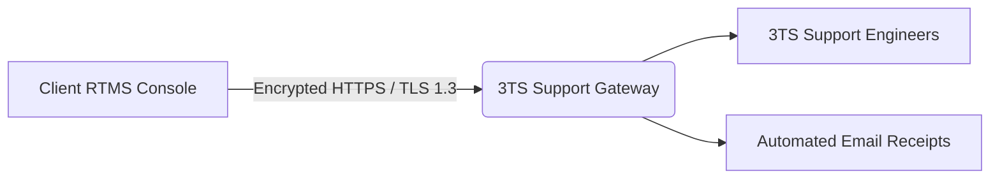

# Technical Support, Secure Gateway & Software Updates

The RTMS platform integrates a direct, secure channel with the **3TS Consulting** central technical support hub, enabling real-time incident ticketing, proactive software update deployment, and automated license lifecycle management.

---

## 1. Submitting and Tracking Support Tickets

Accessible via **Help > Support** (`/help/support`):

### Key Capabilities:
* **Direct Ticket Submission**: Formulate ticket subject, priority (*Low, Normal, High, Critical*), and comprehensive issue descriptions.
* **Optional Diagnostic Telemetry**: Option to bundle non-sensitive platform status metadata (operating system environment, RTMS version, asset count).
  > [!NOTE]
  > No confidential client data (passwords, cleartext network payloads, or personal customer information) is included in diagnostic packages.
* **Real-Time Ticket Tracking**: View status updates, resolution notes from 3TS engineers, and track progress until closure directly from the portal.

---

## 2. Communication Security & Zero-Trust Architecture

All communications between your on-premises RTMS instance and the central support infrastructure adhere to rigorous security standards:

* **End-to-End Encryption (SSL / TLS 1.3)**:  
  All traffic travels exclusively over HTTPS via standard secure port `443` using modern TLS cipher suites and HSTS (*HTTP Strict Transport Security*).
* **Asymmetric Instance Cryptographic Identity (Zero-Trust Ed25519)**:  
  Your RTMS instance generates its own unique Ed25519 asymmetric keypair during setup:
  * **The private key** remains strictly protected within your local server boundary and is never transmitted over the wire.
  * **Each outbound request** is cryptographically signed using an ephemeral authentication token (15-minute validity), guaranteeing message authenticity and preventing replay or spoofing attacks.
* **Corporate API Key Alternative (Bearer Token)**:  
  Clients with specialized outbound proxy policies can alternatively authenticate using a static corporate API key issued by 3TS.

---

## 3. Software Updates Management (`/security/software`)

The **Administration > Software Updates** workspace supports continuous cyber resilience compliance (NIS 2 / Cyber Resilience Act):

1. **Automated Discovery**: The platform polls the official release registry to detect security patches and functional releases.
2. **Release Notes & Fix Details**: Transparent display of resolved vulnerabilities and target component versions (core scanner probe, web dashboard, local NVD engine).
3. **Cryptographic Integrity Validation**: Every staged package is verified against its SHA-256 hash before installation, ensuring tamper-proof delivery.

---

## 4. License Lifecycle & Expansion Requests

When an annual license approaches expiration or additional network assets require monitoring:
* A renewal or tier expansion request can be submitted with 1 click.
* Hardware footprint metrics from authorized probes are compiled and securely transmitted to the technical center for instant license generation and activation.
