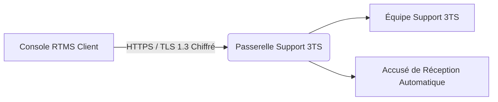

# Support Technique, Passerelle Sécurisée & Mises à Jour

La plateforme RTMS intègre une liaison directe et sécurisée avec le centre de support technique de **3TS Consulting**, permettant la transmission instantanée de tickets d'incident, le suivi des correctifs logiciels et la gestion des licences d'exploitation.

---

## 1. Soumission et Suivi des Tickets de Support

Accessible depuis le menu **Aide > Support** (`/help/support`) :

### Fonctionnalités disponibles :
* **Création directe de tickets** : Renseignement du sujet, de la criticité (*Faible, Normale, Haute, Critique*) et de la description détaillée du problème.
* **Diagnostics techniques optionnels** : Possibilité de joindre un état de santé synthétique de l'appliance (version de l'OS, version RTMS, volumétrie des actifs inventoriés).
  > [!NOTE]
  > Aucune donnée confidentielle d'entreprise (mots de passe, flux réseau sensibles ou données nominatives) n'est transmise dans les diagnostics techniques.
* **Historique et suivi en direct** : Consultation en temps réel des réponses des ingénieurs 3TS, des notes de résolution et de l'état d'avancement du ticket.

---

## 2. Sécurisation des Communications & Architecture Zero-Trust

Toutes les interactions entre votre instance RTMS et le centre de support s'exécutent selon les normes de cybersécurité les plus strictes :

* **Chiffrement de bout en bout (SSL / TLS 1.3)** :  
  L'ensemble du trafic réseau transite via HTTPS sur le port sécurisé standard `443` avec certificat TLS reconnu et validation HSTS (*HTTP Strict Transport Security*).
* **Identité Cryptographique d'Instance (Zero-Trust Ed25519)** :  
  Votre instance RTMS génère sa propre paire de clés asymétriques Ed25519 lors du déploiement :
  * **La clé privée** reste confinée de façon inviolable sur votre serveur local et ne circule jamais sur le réseau.
  * **Chaque requête sortante** est signée numériquement au moyen d'un jeton cryptographique éphémère (validité 15 minutes), garantissant l'authenticité de la source et empêchant toute usurpation ou rejeu malveillant.
* **Alternative par Clé d'API (Bearer Token)** :  
  En cas de politique d'entreprise spécifique, une clé d'API statique dédiée remise par 3TS peut également être configurée.

---

## 3. Gestion des Mises à Jour Logicielles (`/security/software`)

La section **Administration > Mises à jour logicielles** assure la maintenance proactive de la solution en conformité avec les exigences de cyber-résilience (CRA / NIS 2) :

1. **Détection automatique** : L'instance interroge le référentiel officiel 3TS pour vérifier la disponibilité de correctifs de sécurité ou d'évolutions fonctionnelles.
2. **Notes de version & Vulnérabilités comblées** : Affichage transparent des correctifs inclus et des composants mis à jour (moteur de scan, interface web, base locale NVD).
3. **Contrôle d'intégrité cryptographique** : Tout paquet téléchargé est vérifié via son empreinte cryptographique SHA-256 avant déploiement, interdisant toute altération en transit.

---

## 4. Renouvellement et Extension de Licence

Lorsqu'une licence arrive à échéance ou que le périmètre des équipements supervisés s'élargit :
* Une demande de renouvellement ou d'extension de palier peut être soumise en 1 clic.
* L'empreinte technique des sondes actives est compilée de façon sécurisée et transmise au centre technique pour l'émission immédiate du nouveau certificat de licence.
