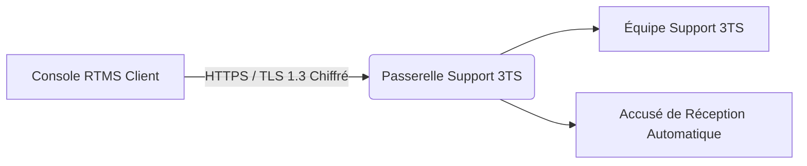
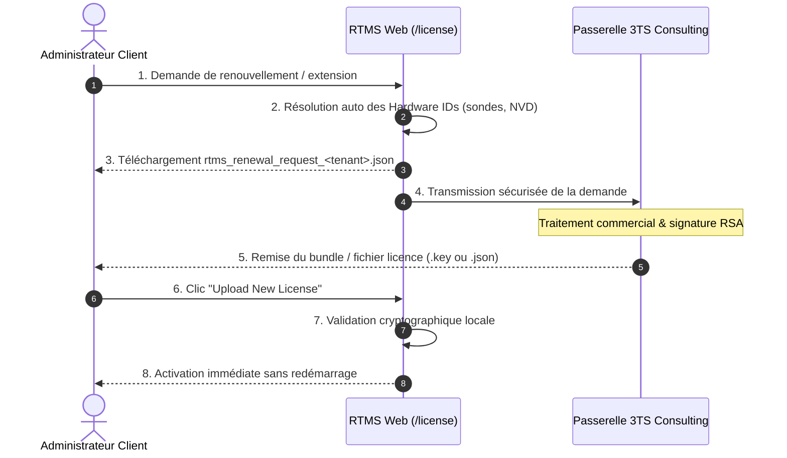

# Support Technique, Passerelle Sécurisée & Mises à Jour

La plateforme RTMS intègre une liaison directe et sécurisée avec le centre de support technique de **3TS Consulting**, permettant la transmission instantanée de tickets d'incident, le suivi des correctifs logiciels et la gestion des licences d'exploitation.

---

## 1. Soumission et Suivi des Tickets de Support

Accessible depuis le menu **Aide > Support** (`/help/support`) :

### Fonctionnalités disponibles :
* **Création directe de tickets** : Renseignement du sujet, de la criticité (*Faible, Normale, Haute, Critique*) et de la description détaillée du problème.
* **Politique de protection & quotas** : Un quota de 10 tickets par tranche de 24h protège la disponibilité du service contre les boucles logicielles, tandis que les incidents majeurs de priorité *Critique* bénéficient d'un canal d'urgence dédié.
* **Diagnostics techniques optionnels** : Possibilité de joindre un état de santé synthétique de l'appliance (version de l'OS, version RTMS, volumétrie des actifs inventoriés).
  > [!NOTE]
  > Aucune donnée confidentielle d'entreprise (mots de passe, flux réseau sensibles ou données nominatives) n'est transmise dans les diagnostics techniques.
* **Historique et suivi en direct** : Consultation en temps réel des réponses des ingénieurs 3TS, des notes de résolution et de l'état d'avancement du ticket.

---

## 2. Sécurisation des Communications & Architecture Zero-Trust

Toutes les interactions entre votre instance RTMS et le centre de support s'exécutent selon les normes de cybersécurité les plus strictes :

* **Chiffrement de bout en bout (SSL / TLS 1.3)** :  
  L'ensemble du trafic réseau transite via HTTPS sur le port sécurisé standard `443` avec certificat TLS reconnu et validation HSTS (*HTTP Strict Transport Security*).
* **Identité Cryptographique d'Instance (Zero-Trust Ed25519)** :  
  Votre instance RTMS génère sa propre paire de clés asymétriques Ed25519 lors du déploiement :
  * **La clé privée** reste confinée de façon inviolable sur votre serveur local et ne circule jamais sur le réseau.
  * **Chaque requête sortante** est signée numériquement au moyen d'un jeton cryptographique éphémère (validité 15 minutes), garantissant l'authenticité de la source et empêchant toute usurpation ou rejeu malveillant.
* **Alternative par Clé d'API (Bearer Token)** :  
  En cas de politique d'entreprise spécifique, une clé d'API statique dédiée remise par 3TS peut également être configurée.

---

## 3. Gestion des Mises à Jour Logicielles (`/security/software`)

La section **Administration > Mises à jour logicielles** assure la maintenance proactive de la solution en conformité avec les exigences de cyber-résilience (CRA / NIS 2) :

1. **Détection automatique** : L'instance interroge le référentiel officiel 3TS pour vérifier la disponibilité de correctifs de sécurité ou d'évolutions fonctionnelles.
2. **Notes de version & Vulnérabilités comblées** : Affichage transparent des correctifs inclus et des composants mis à jour (moteur de scan, interface web, base locale NVD).
3. **Contrôle d'intégrité cryptographique** : Tout paquet téléchargé est vérifié via son empreinte cryptographique SHA-256 avant déploiement, interdisant toute altération en transit.

---

## 4. Renouvellement et Extension de Licence (Procédure Utilisateur)

L'administration des licences d'exploitation pour les clients et organisations s'effectue intégralement depuis le portail RTMS Web via l'écran **Paramètres > Souscription & Licence** (`/license`). 

Les organisations clientes n'ont pas accès à la génération de clés brutes (processus cryptographique réservé à l'autorité 3TS) : la procédure officielle repose sur le **cycle de demande de renouvellement et d'importation de bundle (Option B)**.

### Étape 1 : Consultation de l'état de la licence
Depuis l'écran `/license` :
* Visualisez la formule active (**NVD**, **Discovery**, **Secure** ou **Compliance**) et sa date d'échéance.
* Vérifiez la jauge d'actifs monitorés par rapport au plafond souscrit (ex. 248 / 250 IPs).
* Consultez la liste des sondes matérielles et microservices enregistrés avec leurs identifiants matériels (*Hardware IDs*).

### Étape 2 : Déclenchement de la demande de renouvellement ou d'upgrade
1. Cliquez sur le bouton **« Mettre à niveau la licence »** (ou **« Demander une mise à niveau anticipée »** si votre volumétrie approche de la limite).
2. Sélectionnez la **Formule souhaitée** ainsi que le **Palier d'actifs** cible (ex: 50, 250, 500 ou 1000+ adresses IP).
3. Ajoutez d'éventuelles notes ou spécifications dans le champ prévu à cet effet.

### Étape 3 : Génération et transmission de la demande
Cliquez sur **« Générer la demande de renouvellement »** :
* **Résolution automatique des identifiants matériels** : La plateforme compile automatiquement les empreintes uniques de votre instance, de vos sondes actives et de votre moteur CVE local, évitant toute saisie manuelle d'UUID.
* **Téléchargement du fichier de demande** : Un fichier nommé `rtms_renewal_request_<tenant_id>.json` est automatiquement téléchargé dans votre dossier local de téléchargements.
* **Transmission automatique** : Si la liaison avec la passerelle technique 3TS est configurée, la demande est instantanément transmise de manière chiffrée avec accusé de réception (`RTMS-LIC-YYYY-XXXX`). Dans le cas contraire, transmettez ce fichier `.json` par courriel à votre interlocuteur 3TS Consulting.

### Étape 4 : Importation et activation de la nouvelle licence
Dès réception de votre nouvelle licence émise et signée par 3TS (fichier individuel `.key` ou bundle multi-sondes `rtms_license_bundle_<tenant_id>.json`) :
1. Retournez sur l'écran **Paramètres > Souscription & Licence** (`/license`).
2. En haut à droite de l'écran, cliquez sur **« Upload New License »**.
3. Sélectionnez le fichier `.key` ou `.json` fourni par 3TS.
4. L'instance procède instantanément au contrôle cryptographique de la signature RSA-2048.
5. **Prise d'effet immédiate** : Dès validation, les nouveaux plafonds et dates d'échéance s'affichent à l'écran. Aucune coupure de service ni redémarrage des sondes ou de la machine n'est nécessaire.
