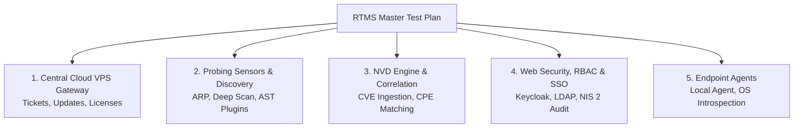

# Master Test Plan & Platform Qualification Strategy

This document establishes the official testing framework and qualification roadmap for the **RTMS (Real-Time Monitoring & Security)** software suite for **3TS Consulting SRL** engineers.

---

## 1. Objectives of the Qualification Strategy

The verification and validation framework guarantees:
1. **End-to-End Functional Integrity** across probing sensors (`rtms-scanner`), local introspection agents (`rtms-local-agent`), central management node (`rtms-web`), and central cloud gateway (`rtms-admin` on OVH VPS).
2. **Regulatory & Compliance Adherence**: European **NIS 2 Directive** (continuous cyber hygiene, RBAC access control, mandatory MFA, strong crypto) and **Cyber Resilience Act (CRA)** (SBOM traceability, signed updates, package integrity).
3. **Zero-Trust Network Isolation**: Strict partitioning between internal management interfaces (WireGuard) and public exchange endpoints (HTTPS).

---

## 2. Modular Test Plan Breakdown

The master qualification suite is divided into specialized modules:

| Test Module | Scope & Target Components | Status | Reference Document |
| :--- | :--- | :--- | :--- |
| **Module 1: Central VPS Gateway** | Support ticketing, software release distribution, and license renewals via `updates.3ts.ai` | **Active & Detailed** | [VPS Gateway Test Plan](vps_gateway_endpoints.md) |
| **Module 2: Network Probes & Scanners** | Host discovery, top-1000 port audit, security plugins (SMTP, DNS, Web), and standalone mode | Under development | *Coming soon* |
| **Module 3: NVD Microservice** | NIST v2.0 delta ingestion, local PostgreSQL schema, and CPE matching engine | Under development | *Coming soon* |
| **Module 4: Web Console, RBAC & NIS 2** | Hybrid authentication (SSO/Local), 4 RBAC roles, CRA/SBOM export, and immutable audit trail | Under development | *Coming soon* |
| **Module 5: Endpoint Agents** | Telemetry ingestion, package inventory, and binary signatures | Under development | *Coming soon* |

---

## 3. Test Case Specification Standard

Every test case adheres to a structured definition:
* **Unique ID**: e.g., `TC-VPS-TICKETS-01`.
* **Prerequisites & Context**: API tokens, keys, certificates, network routes.
* **Execution Procedure**: Direct curl invocations, UI interactive walkthroughs, and backend SQL queries.
* **Pass / Fail Acceptance Criteria**: HTTP status codes, JSON payload schemas, and database row states.
