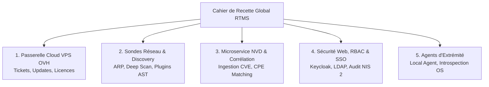

# Plan Directeur de Tests & Qualification Plateforme (Master Test Plan)

Ce document établit le cadre de référence et la stratégie de qualification de la suite logicielle **RTMS (Real-Time Monitoring & Security)** pour l'équipe technique de **3TS Consulting SRL**.

---

## 1. Objectifs de la Stratégie de Qualification

La démarche de test vise à garantir :
1. **L'intégrité fonctionnelle de bout en bout** entre les sondes (`rtms-scanner`), les agents (`rtms-local-agent`), l'application centrale (`rtms-web`) et la passerelle centrale cloud (`rtms-admin` sur VPS OVH).
2. **Le respect des exigences réglementaires** : Directive européenne **NIS 2** (audit continu, contrôle d'accès RBAC, MFA obligatoire, chiffrement fort) et règlement **Cyber Resilience Act (CRA)** (traçabilité SBOM, résilience et intégrité signée des correctifs).
3. **Le cloisonnement Zero-Trust & Sécurité réseau** : Isolation stricte entre les interfaces administratives internes (WireGuard) et les passerelles publiques d'échange (HTTPS).

---

## 2. Découpage Modulaire des Cahiers de Test

Le plan de validation global se décline en cahiers d'essais spécialisés :

| Module de Test | Périmètre & Composants Cibles | Statut | Document de Référence |
| :--- | :--- | :--- | :--- |
| **Module 1 : Passerelle VPS Cloud** | Endpoints de support, distribution de releases logicielles et gestion des licences via `updates.3ts.ai` | **Actif & Détaillé** | [Cahier de Test Passerelle VPS](vps_gateway_endpoints.md) |
| **Module 2 : Sondes & Scanners Réseau** | Découverte d'hôtes, balayage top-1000 ports, plugins de sécurité (SMTP, DNS, Web) et mode autonome | En cours de rédaction | *À paraître* |
| **Module 3 : Microservice NVD** | Ingestion delta NIST v2.0, base CVE locale durcie et moteur de matching CPE | En cours de rédaction | *À paraître* |
| **Module 4 : Console Web, RBAC & NIS 2** | Authentification hybride (SSO/Local), 4 rôles RBAC, export CRA/SBOM et journal d'audit immuable | En cours de rédaction | *À paraître* |
| **Module 5 : Agents d'Extrémité** | Synchronisation télémétrique, inventaire des packages et signatures binaires | En cours de rédaction | *À paraître* |

---

## 3. Méthodologie d'Exécution & Niveaux de Rigueur

Chaque cas de test est documenté avec :
* **Identifiant unique** : ex. `TC-VPS-TICKETS-01`.
* **Prérequis & Environnement** : Clés d'API, certificats, connectivité réseau.
* **Procédure d'exécution** : Commandes curl directes, manipulations dans l'interface Web (UI) et requêtes SQL de vérification.
* **Résultats attendus & Critères d'acceptation** : Codes HTTP, structures JSON et persistances en base de données.
